# Volledig Gedetailleerd Master Implementatieplan: Spekadvies Moerkapelle

Dit document is de **technische en inhoudelijke blauwdruk** voor de volledige transformatie van **Spekadvies** (`spekadvies.nl`), het onafhankelijk hypotheek- en financieel advieskantoor van **Martin van der Spek**, gevestigd aan de **Herenweg 42 te Moerkapelle**.

Het plan is verdeeld in **8 strak afgebakende fasen**. Elke fase bevat de exacte bestandspaden, code-aanpassingen, lay-outcomponenten, DataForSEO verantwoordingen en GEO AI integraties, zodat na goedkeuring de uitvoering in één vloeiende reeks kan plaatsvinden zonder openstaande vragen.

---

## Overzicht van de 8 Uitvoeringsfasen

```mermaid
flowchart LR
    Fase1["Fase 1: Fundering & Entiteiten"] --> Fase2["Fase 2: Navigatie & 5-Koloms Footer"]
    Fase2 --> Fase3["Fase 3: Subdienst Layoutmodel"]
    Fase3 --> Fase4["Fase 4: 8 Hypotheek Sub-Silo's"]
    Fase4 --> Fase5["Fase 5: 4 Verzekering Sub-Silo's"]
    Fase5 --> Fase6["Fase 6: Kennisbank Systeem"]
    Fase6 --> Fase7["Fase 7: 8 Regio Locaties"]
    Fase7 --> Fase8["Fase 8: Validatie & Go-Live"]
```



---

## Fase 1: Technische Fundering, Entiteits-Configuratie & Schema.org

### Doel
Het vastleggen van de harde entiteitsgegevens van Spekadvies in Moerkapelle in een centraal configuratiebestand en het genereren van een agency-grade Schema.org entiteitennetwerk (`FinancialService`, `Person`, `BreadcrumbList`).

### Bestanden

#### `[NEW]` `src/data/company.ts`
Centraal configuratiebestand met alle officiële bedrijfs-, contact- en vergunningsgegevens van Spekadvies.
```typescript
export const COMPANY_DATA = {
  name: 'Spekadvies',
  legalName: 'Spek Advies B.V.',
  tradeName: 'vd Spek Financiële Diensten',
  founder: {
    name: 'Martin van der Spek',
    role: 'Erkend Hypothecair Planner & Financieel Adviseur',
    bio: 'Al meer dan 20 jaar het vaste, onafhankelijke gezicht voor hypotheken en verzekeringen in Moerkapelle en omstreken.',
    avatar: '/assets/martin-van-der-spek.jpg',
  },
  address: {
    street: 'Herenweg 42',
    postalCode: '2751 DB',
    city: 'Moerkapelle',
    region: 'Zuid-Holland',
    country: 'NL',
  },
  geo: {
    latitude: 52.0467,
    longitude: 4.5772,
  },
  contact: {
    phone: '079 593 1241',
    phoneRaw: '+31795931241',
    email: 'info@spekadvies.nl',
    whatsapp: '+31795931241',
  },
  openingHours: {
    days: 'Maandag t/m Vrijdag',
    hours: '09:00 – 18:00 uur (avondafspraken op verzoek)',
  },
  ratings: {
    score: '4.9',
    count: 250,
    bestRating: '5',
  },
  compliance: {
    afmReg: 'Wft Vergunninghoudend Financieel Dienstverlener',
    kvk: 'Geregistreerd bij Kamer van Koophandel',
    vergelijkingskaart: '/docs/Vergelijkingskaart.pdf',
  },
  catchmentAreas: [
    'Moerkapelle', 'Waddinxveen', 'Gouda', 'Zoetermeer',
    'Zevenhuizen', 'Nieuwerkerk aan den IJssel', 'Moordrecht', 'Lansingerland'
  ]
};
```

#### `[NEW]` `src/components/FaqSchema.astro`
Generieke, herbruikbare Schema.org generator die automatische `FAQPage` microdata injecteert voor elke pagina met FAQ's.
```astro
---
interface Props {
  faqItems: Array<{ question: string; answer: string }>;
}
const { faqItems } = Astro.props;
---
{faqItems && faqItems.length > 0 && (
  <script type="application/ld+json" is:inline set:html={JSON.stringify({
    "@context": "https://schema.org",
    "@type": "FAQPage",
    "mainEntity": faqItems.map(item => ({
      "@type": "Question",
      "name": item.question,
      "acceptedAnswer": {
        "@type": "Answer",
        "text": item.answer
      }
    }))
  })} />
)}
```

#### `[MODIFY]` `src/layouts/Layout.astro`
- Update JSON-LD van statische dummy naar dynamische koppeling met `COMPANY_DATA`.
- Toevoegen van `Person` entiteit (**Martin van der Spek**) gekoppeld aan de `FinancialService`.
- Instellen van de officiële canonical en Open Graph metadata op `https://www.spekadvies.nl`.

---

## Fase 2: Navigatie- & Footer-Transformatie (Conform De Stukadoor Den Haag)

### Doel
Het stroomlijnen van de bovenste menubalk (Navbar) door alle links naar Locaties en Kennisbank te verwijderen en deze krachtig onder te brengen in een 5-koloms footer.

### Bestanden

#### `[MODIFY]` `src/components/Navbar.astro`
- **Verwijderen:** Dropdown "Locaties" en link naar "Kennisbank".
- **Samenstelling Menu:**
  1. **Hypotheken ▼:** Dropdown met directe links naar de 8 sub-silo's + "Alle hypotheken bekijken".
  2. **Verzekeringen ▼:** Dropdown met directe links naar AOV ZZP, Woonverzekering, ORV, Bedrijfsverzekering + "Alle verzekeringen".
  3. **Aangiften & Belastingen:** Directe link naar `/aangiften`.
  4. **Over ons:** Directe link naar `/over-ons`.
  5. **Contact:** Knop die de `ContactDrawer` triggert.
- **Actie-elementen rechts:**
  - Direct bellen: `079 593 1241` (met telefoonicoon en openingstijden).
  - CTA-knop: `Gratis adviesgesprek`.

#### `[MODIFY]` `src/components/Footer.astro`
Herstructurering naar de bewezen 5-koloms indeling van `destukadoordenhaag.nl`:
- **Kolom 1 (NAP-W & Merk):** Logo Spekadvies, Martin van der Spek, adres Herenweg 42 Moerkapelle, telefoon, e-mail, openingstijden en AFM/Wft trust badge.
- **Kolom 2 (Hypotheek Sub-Silo's):** Directe interne links naar alle 8 hypotheekpagina's.
- **Kolom 3 (Verzekeringen):** Directe interne links naar AOV voor ZZP, Opstal/Inboedel, ORV en Bedrijfsverzekeringen.
- **Kolom 4 (Werkgebied Regio):** Link naar `/locaties` + individuele ankers: Moerkapelle, Waddinxveen, Gouda, Zoetermeer, Zevenhuizen, Nieuwerkerk a/d IJssel, Moordrecht, Lansingerland.
- **Kolom 5 (Kennis & Advies):** Link naar `/kennisbank` + directe links naar de belangrijkste gidsen (*Hoe werkt overbrugging?*, *Boeterente berekenen*, *Starterslening SVn*, etc.).
- **Sub-footer:** Copyright 2026, Vergelijkingskaart download, Privacyverklaring en Algemene Voorwaarden.

---

## Fase 3: Het Subdienst Layoutmodel & Schema-Uitbreiding

### Doel
Het ontwikkelen van een uniform, visueel hoogstaand lay-outsjabloon voor subdienstpagina's, geïnspireerd op het Bento Grid- en redactionele model van De Stukadoor Den Haag, maar 100% toegespitst op financieel advies.

### De 7 Visuele Secties van het Subdienstmodel

```
+---------------------------------------------------------------------------------------------------------+
| [SECTIE 1] HERO HEADER:                                                                                 |
| - Kruimelpad: Home > Hypotheken > [Subdienst]                                                           |
| - Actieve H1 (Exact-match zoekterm + Regio Moerkapelle)                                                 |
| - Subtitel met berekende voordelen & 40+ aanbieders vergelijking                                        |
| - CTA Knoppen: [Plan gratis adviesgesprek] & [Bereken direct online]                                   |
+---------------------------------------------------------------------------------------------------------+
| [SECTIE 2] 3-KOLOMS STATS & USP BENTO CARDS:                                                           |
| - Card 1: Relevante cijfer-statistiek (bijv. "Tot 100% overwaarde overbruggen" of "Vanaf 1 jaar ZZP")   |
| - Card 2: Onafhankelijkheid (40+ banken vergeleken op voorwaarden en laagste rente)                    |
| - Card 3: Lokale garantie (Martin van der Spek aan de Herenweg 42 of bij jou thuis aan de keukentafel)   |
| [SECTIE 3] PERSOONLIJKE HAALBAARHEIDSCHECK & ADVIES BANNER:                                            |
| - Geen haperende of onbetrouwbare calculator-widgets, maar een krachtige vertrouwensbanner:              |
|   "Wil je exact weten wat jouw maximale hypotheek of maandlasten worden? Martin van der Spek rekent     |
|   het binnen 24 uur kosteloos en onafhankelijk voor je uit. Geen vage schattingen, maar 100% maatwerk."  |
| - Knoppen: [Plan gratis adviesgesprek (binnen 24u contact)] & [Bel direct: 079 593 1241]                |
| [SECTIE 4] REDACTIONELE VERDIEPING MET GESTRUCTUREERDE VERGELIJKINGSTABEL:                             |
| - Diepgaande uitleg van het financieringsproces (geen lappen tekst, maar gestructureerde alinea's)      |
| - Officiële Vergelijkingstabel (bijv. Meeneemregeling vs. Nieuwe Rente, of Looptijden & Boeteberekening)|
| - Callout boxes met Expert Tips en Waarschuwingen (E-E-A-T)                                            |
+---------------------------------------------------------------------------------------------------------+
| [SECTIE 5] GEO AI FAQ ACCORDIONS (MET FAQPAGE SCHEMA):                                                 |
| - 4 tot 6 specifieke zoekvragen met beknopte 40-60 woorden directe antwoorden                          |
+---------------------------------------------------------------------------------------------------------+
| [SECTIE 6] SOCIAL PROOF & REVIEWCARDS:                                                                 |
| - Klantbeoordeling 4.9/5 en echte reviews van starters, doorstromers of ondernemers uit de regio        |
+---------------------------------------------------------------------------------------------------------+
| [SECTIE 7] CONVERSIE FOOTER-CTA:                                                                        |
| - "Jouw financiering perfect geregeld? Plan jouw kosteloze intake in Moerkapelle of bij jou thuis"      |
+---------------------------------------------------------------------------------------------------------+
```

### Bestanden

#### `[MODIFY]` `src/content.config.ts`
Uitbreiding van het Zod-schema voor de `diensten` collectie zodat vergelijkingstabellen, statistiek-kaarten en categorieën type-safe worden ondersteund:
```typescript
const seoPageSchema = z.object({
  name: z.string(),
  seoTitle: z.string(),
  seoDescription: z.string(),
  heroTitle: z.string(),
  heroSubtitle: z.string(),
  ctaText: z.string().default("Gratis adviesgesprek inplannen"),
  category: z.enum(['hypotheken', 'verzekeringen', 'belastingen']).default('hypotheken'),
  badgeText: z.string().default('Onafhankelijk Advies Moerkapelle'),
  statCard: z.object({
    number: z.string(),
    label: z.string(),
    description: z.string(),
  }).optional(),
  usps: z.array(z.object({
    icon: z.string().optional(),
    title: z.string(),
    description: z.string()
  })).optional(),
  comparisonTable: z.object({
    title: z.string().optional(),
    headers: z.array(z.string()),
    rows: z.array(z.array(z.string())),
  }).optional(),
  faqItems: z.array(z.object({
    question: z.string(),
    answer: z.string()
  })).optional(),
  articleBlocks: z.array(z.object({
    title: z.string(),
    body: z.string(),
    callout: z.object({
      type: z.enum(['tip', 'warning', 'info']),
      text: z.string()
    }).optional()
  })).optional()
});
```

#### `[MODIFY]` `src/pages/diensten/[slug].astro`
Aanpassen van de template om de 7 secties van het nieuwe subdienstmodel foutloos te renderen, inclusief de integratie van `FaqSchema.astro` en gestructureerde vergelijkingstabellen.

---

## Fase 4: Realisatie van de 8 Hypotheek Sub-Silo's

### Doel
Het schrijven en publiceren van de 8 specifieke hypotheekpagina's onder `src/content/diensten/`, voorzien van actieve zoekintentie-titels, vergelijkingstabellen en GEO FAQ's.

### De 8 Paginaspecificaties

#### 4.1 `startershypotheek.md` [MODIFY]
* **Zoekvolume:** `startershypotheek` (1.600/mnd), `starterslening` (honderden lokaal).
* **H1:** `Startershypotheek & Starterslening in Moerkapelle en Omstreken`
* **Vergelijkingstabel:** *Annuïtair vs. Lineair vs. Starterslening SVn (Rente, Maandlasten, Aflossingsvrij eerste 3 jaar)*.
* **GEO FAQ's:**
  1. *Hoe vraag ik een Starterslening aan via SVn in Moerkapelle of Zuidplas?*
  2. *Welke eigen geld kosten heb ik als starter (kosten koper)?*
  3. *Wat zijn de voordelen van NHG voor starters in 2026?*

#### 4.2 `doorstromers-en-overbruggingshypotheek.md` [NEW]
* **Zoekvolume:** `overbruggingshypotheek` (**5.400/mnd!**), `hypotheek meenemen` (320/mnd).
* **H1:** `Doorstromers & Overbruggingshypotheek: Jouw Volgende Huis Zorgeloos Gekocht`
* **Vergelijkingstabel:** *Woning definitief verkocht (100% overwaarde) vs. Woning nog te koop (90% overwaarde)*.
* **GEO FAQ's:**
  1. *Hoeveel overbruggingshypotheek kan ik krijgen en wat kost dit per maand?*
  2. *Kan ik mijn lage hypotheekrente meenemen naar mijn volgende woning?*
  3. *Wat gebeurt er als mijn oude woning niet direct wordt verkocht?*

#### 4.3 `hypotheek-oversluiten.md` [MODIFY]
* **Zoekvolume:** `hypotheek oversluiten` (**2.900/mnd!**), `boeterente berekenen` (210/mnd).
* **H1:** `Hypotheek Oversluiten in Moerkapelle: Bespaar Maandelijks op Jouw Lasten`
* **Vergelijkingstabel:** *Huidige rente vs. Nieuwe rente: Terugverdientijd van boeterente en advieskosten*.
* **GEO FAQ's:**
  1. *Hoe hoog is de boete bij het oversluiten van mijn hypotheek?*
  2. *Wanneer kan ik mijn hypotheek boetevrij oversluiten of aanpassen?*
  3. *Heeft oversluiten zin als ik nog een korte rentevastperiode heb?*

#### 4.4 `overwaarde-en-verzilverhypotheek.md` [NEW]
* **Zoekvolume:** `opeethypotheek` (**2.900/mnd!**), `overwaarde verzilveren` (1.300/mnd), `senioren hypotheek` (1.000/mnd).
* **H1:** `Overwaarde Verzilveren & Opeethypotheek voor Senioren in Moerkapelle`
* **Vergelijkingstabel:** *Opeethypotheek vs. Krediethypotheek vs. Verzilverlening (Inkomenseisen, Maandlasten, Restschuldgarantie)*.
* **GEO FAQ's:**
  1. *Wat is een opeethypotheek en hoe werkt dit voor gepensioneerden?*
  2. *Stijgen mijn maandlasten als ik overwaarde opneem?*
  3. *Kan ik de overwaarde belastingvrij schenken aan mijn kinderen?*

#### 4.5 `zzp-ondernemershypotheek.md` [NEW]
* **Zoekvolume:** `zzp hypotheek` (720/mnd), `hypotheek ondernemer` (480/mnd).
* **H1:** `Hypotheek voor ZZP & Ondernemers in Moerkapelle: Maatwerk Financiering`
* **Vergelijkingstabel:** *Toetsinkomen berekening: 1 jaar ZZP vs. 2 jaar vs. 3 jaar jaarcijfers*.
* **GEO FAQ's:**
  1. *Kan ik als ZZP'er al na 1 jaar een hypotheek krijgen?*
  2. *Wat is een Inkomensverklaring Ondernemer (IAK) en hoe werkt dit?*
  3. *Tellen afschrijvingen en fiscale aftrekposten mee voor mijn leencapaciteit?*

#### 4.6 `nieuwbouw-en-verbouwingshypotheek.md` [NEW]
* **Zoekvolume:** `bouwdepot hypotheek` (480/mnd), `nieuwbouw hypotheek` (320/mnd), `nieuwbouw moerkapelle` (140/mnd).
* **H1:** `Nieuwbouw Hypotheek & Bouwdepot: Financiering voor De Jonge Veenen & Regio`
* **Vergelijkingstabel:** *Bestaande bouw vs. Nieuwbouw (V.O.N., Dubbele lasten, Bouwrente vs. Depotrente)*.
* **GEO FAQ's:**
  1. *Hoe werkt een bouwdepot en renteverlies tijdens de nieuwbouw?*
  2. *Kan ik dubbele maandlasten tijdens de bouw meefinancieren?*
  3. *Hoe financier ik nieuwbouw in projecten zoals De Jonge Veenen in Moerkapelle?*

#### 4.7 `hypotheek-verduurzamen.md` [NEW]
* **Zoekvolume:** `hypotheek verduurzamen` (90/mnd), `energiebespaarbudget` (90/mnd).
* **H1:** `Hypotheek Verduurzamen: Energiebespaarbudget & Rentekorting`
* **Vergelijkingstabel:** *Energiebespaarbudget (tot €10.000) vs. Energiebespaarlening vs. Rentekorting per energielabel*.
* **GEO FAQ's:**
  1. *Hoeveel kan ik extra lenen voor energiebesparende voorzieningen?*
  2. *Krijg ik rentekorting bij een energielabel A of A+?*
  3. *Kan ik zonnepanelen en een warmtepomp meefinancieren in mijn bestaande hypotheek?*

#### 4.8 `scheiden-en-hypotheek.md` [NEW]
* **Zoekvolume:** `hypotheek bij scheiding` (480/mnd), `partner uitkopen` (140/mnd).
* **H1:** `Hypotheek bij Scheiding in Moerkapelle: Partner Uitkopen & Woning Voortzetten`
* **Vergelijkingstabel:** *Partner uitkopen vs. Woning gezamenlijk verkopen (Fiscale gevolgen Box 1, Overbedelingsschuld)*.
* **GEO FAQ's:**
  1. *Hoe werkt ontslag uit de hoofdelijke aansprakelijkheid bij een scheiding?*
  2. *Kan ik de bestaande lage hypotheekrente behouden als ik de woning overneem?*
  3. *Hoe wordt de uitkoopwaarde van de vertrekkende partner berekend?*

---

## Fase 5: Realisatie van de 4 Verzekering Sub-Silo's

### Doel
Het bouwen van specifieke verzekeringspagina's onder `src/content/diensten/` gericht op inkomenszekerheid en schadeverzekeringen.

### Bestanden
1. **`aov-verzekering.md`** [MODIFY]
   * *Zoekvolume:* `aov verzekering zzp` (**2.400/mnd**, CPC €21,37).
   * *H1:* `AOV Verzekering voor ZZP & Ondernemers in Moerkapelle & Regio`
   * *Inhoud:* Vergelijking traditionele AOV vs. Schenkkring/Broodfonds, wachttijden en premie-aftrekbaarheid.
2. **`woonverzekeringen.md`** [NEW]
   * *Zoekvolume:* `woonverzekering vergelijken` (**2.400/mnd**).
   * *H1:* `Woonverzekeringen: Opstal- en Inboedelverzekering Vergelijken`
   * *Inhoud:* Garantie tegen onderverzekering, glasdekking, herbouwwaarde bij hypotheekafsluiting.
3. **`overlijdensrisicoverzekering.md`** [NEW]
   * *Zoekvolume:* `overlijdensrisicoverzekering` (1.900/mnd).
   * *H1:* `Overlijdensrisicoverzekering: Financiële Zekerheid voor Jouw Gezin`
   * *Inhoud:* Gelijkblijvende vs. lineair/annuïtair dalende dekking, premievergelijking top-10 verzekeraars.
4. **`bedrijfsverzekeringen.md`** [NEW]
   * *Zoekvolume:* Bedrijfsaansprakelijkheid (AVB), inventaris, zakelijke rechtsbijstand.
   * *H1:* `Bedrijfsverzekeringen voor Ondernemers in Moerkapelle & Omstreken`
   * *Inhoud:* Risico-inventarisatie voor zzp'ers, mkb en agrarische ondernemers in Moerkapelle.

---

## Fase 6: Realisatie van het Kennisbanksysteem (`/kennisbank`)

### Doel
Het bouwen van de redactionele Kennisbank exact naar model van `destukadoordenhaag.nl`, waarmee Spekadvies groeit naar dé online informatiebron voor hypotheekvragen.

### Bestanden

#### `[NEW]` `src/data/kennisbank.ts`
Definitie van het TypeScript type `KennisbankArticle` en de eerste 8 complete artikelen met GEO Direct Answers, auteursgegevens van Martin van der Spek, vergelijkingstabellen en FAQ's:
1. `hoe-werkt-een-overbruggingshypotheek` (5.400/mnd intentie)
2. `wat-kost-een-hypotheekadviseur` (880/mnd intentie)
3. `boeterente-berekenen-bij-oversluiten` (2.900/mnd intentie)
4. `starterslening-aanvragen-moerkapelle-regio` (lokale intentie)
5. `overwaarde-huis-verzilveren-senioren` (2.900/mnd intentie)
6. `hypotheek-afsluiten-als-zzper` (720/mnd intentie)
7. `nieuwbouw-financieren-bouwdepot` (De Jonge Veenen & Park Triangel)
8. `hypotheek-bij-scheiding-partner-uitkopen` (480/mnd intentie)

#### `[NEW]` `src/pages/kennisbank/index.astro`
- Categorie-filterknoppen: *Alle artikelen, Overbruggen & Verhuizen, Oversluiten & Besparen, Starters & Subsidies, Senioren & Overwaarde, ZZP*.
- Zoekbalk met instant JavaScript filtering.
- Rijke artikelkaarten met leestijd, publicatiedatum en samenvatting.

#### `[NEW]` `src/pages/kennisbank/[slug].astro`
- Hero sectie met breadcrumbs en leestijd.
- **GEO Direct Answer Callout Box:** Opvallend vormgegeven quote-box met het 40-60 woorden antwoord voor AI-zoekmachines.
- **Auteur E-E-A-T Card:** Martin van der Spek met rol, kantoorlocatie en AFM-accreditatie.
- **Vergelijkingstabel:** Gestructureerde HTML-tabel.
- **Inhoudelijke Secties:** Met tips en waarschuwingen.
- **FAQ Accordions:** Met automatische `FaqSchema.astro` microdata.
- **Gerelateerde Diensten:** Interne links naar de bijbehorende hypotheeksilo's.

---

## Fase 7: Hyperlokale Regiopagina's Verankeren vanuit Thuisbasis Moerkapelle

### Doel
Het perfectioneren van de 8 locatiepagina's in `src/content/locaties/`, waarbij Moerkapelle (Herenweg 42) de centrale thuisbasis is en de omliggende plaatsen worden bediend met een duidelijke lokale context.

### De 8 Locatiebestanden (`src/content/locaties/*.md`)

1. **`moerkapelle.md`** [MODIFY]
   * *Positionering:* De standplaats. Kantoor aan de Herenweg 42.
   * *Lokale context:* Nieuwbouw De Jonge Veenen (140/mnd nieuwbouw Moerkapelle), Starterslening Gemeente Zuidplas.
2. **`waddinxveen.md`** [NEW]
   * *Positionering:* Directe buurgemeente (4 km, 7 min rijden).
   * *Lokale context:* Nieuwbouw Park Triangel, SVn Starterslening Waddinxveen (50/mnd, CPC €24,18!).
3. **`gouda.md`** [NEW]
   * *Positionering:* 10 km ten oosten van kantoor Moerkapelle.
   * *Lokale context:* Westergouwe nieuwbouw (170/mnd), Bloemendaal, Plaswijck, Starterslening Gemeente Gouda (140/mnd).
4. **`zoetermeer.md`** [MODIFY]
   * *Positionering:* 7 km ten westen, direct grenzend via Oosterheem / Willem-Alexander Baan.
   * *Lokale context:* Oosterheem, Palenstein, Starterslening Zoetermeer (90/mnd).
5. **`zevenhuizen.md`** [MODIFY]
   * *Positionering:* 5 km ten zuiden van kantoor Moerkapelle.
   * *Lokale context:* Koningskwartier, Zuidplaspolder, advies op kantoor of aan de keukentafel.
6. **`nieuwerkerk-aan-den-ijssel.md`** [NEW]
   * *Positionering:* 9 km ten zuiden van kantoor Moerkapelle.
   * *Lokale context:* Grootste kern van Zuidplas (22.000 inwoners), Esse Laag/Hoog, Cortenoever.
7. **`moordrecht.md`** [NEW]
   * *Positionering:* 11 km ten zuiden van kantoor Moerkapelle.
   * *Lokale context:* Historisch IJsseldorp, dorps wonen langs de Hollandse IJssel (40/mnd advies).
8. **`lansingerland.md`** [NEW]
   * *Positionering:* Direct ten westen via Bleiswijk (Rottemeren), Bergschenhoek en Berkel en Rodenrijs.
   * *Lokale context:* Starterslening Lansingerland (70/mnd), top CPC van €61,76 in Berkel.

---

## Fase 8: End-to-End Verificatie, Build, Rich Results Test & Sitemap Validatie

### Doel
Het geautomatiseerd en handmatig testen van de volledige oplevering om 100% foutloze werking te garanderen vóór livegang.

### Stappen
1. **Astro Project Build:**
   ```powershell
   npm run build
   ```
   *Eis: 0 fouten, alle dynamic routes (`/diensten/[slug]`, `/kennisbank/[slug]`, `/hypotheekadviseur-in/[slug]`) compileren succesvol.*
2. **Schema.org Rich Data Validatie:**
   - Geautomatiseerde Node.js inspectie van de HTML-bestanden in `dist/`.
   - Eis: Foutloze aanwezigheid van `FAQPage` op elke subdienst, locatie en kennisbankpagina; valide `FinancialService` en `Person` op de hoofdpagina's.
3. **Sitemap Index Audit:**
   - Controleer `dist/sitemap-0.xml`.
   - Eis: De sitemap groeit van 14 naar **meer dan 40 actieve, geïndexeerde URL's** met `https://www.spekadvies.nl/` als basis.
4. **Navigatie & Footer Verificatie:**
   - Controleer dat de Navbar strak is zonder Kennisbank of Locaties.
   - Controleer dat de Footer alle 5 kolommen toont met correct werkende interne links.
5. **Contact Flow & Adviesaanvragen:**
   - Test het openen van de `ContactDrawer` vanaf alle nieuwe subdienst- en locatiepagina's.
